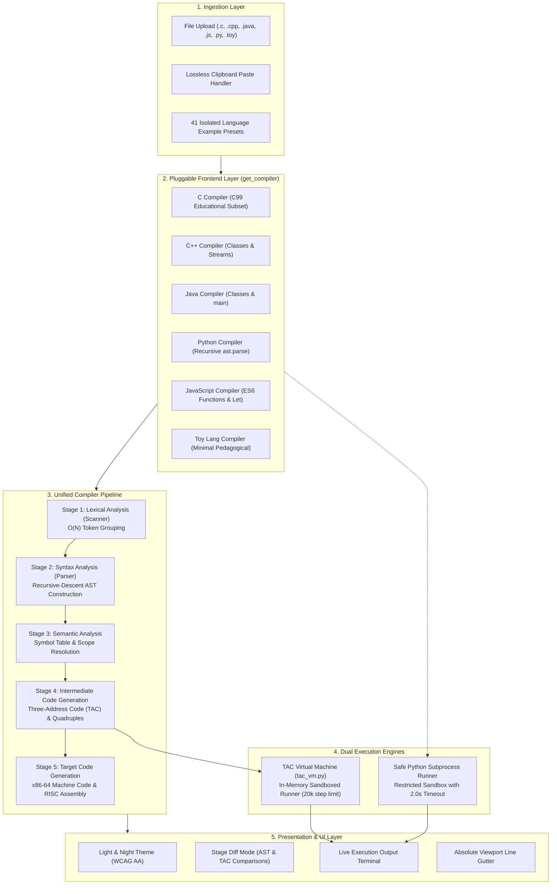

# Compiler Pipeline Visualizer (CPV)
## Comprehensive Final Project Engineering & Architectural Report

> **Course**: BCSE307P — Compiler Design  
> **Evaluation Phase**: Review 3 (Final Comprehensive Review)  
> **Project Team**:  
> • **Ansuman Singh** (Registration No: `24BCE2013`)  
> • **Sayan Giri** (Registration No: `24BCT0281`)  
> **Live Production URL**: [https://compiler-pipeline-visualizer-mocha.vercel.app/](https://compiler-pipeline-visualizer-mocha.vercel.app/)  
> **GitHub Repository**: [https://github.com/giri-sayan/compiler-pipeline-visualizer](https://github.com/giri-sayan/compiler-pipeline-visualizer)

---

## 1. Executive Summary

The **Compiler Pipeline Visualizer (CPV)** is an interactive, multi-language compiler engineering platform and educational sandbox designed to demystify every phase of program compilation and execution. While traditional computer science curricula treat compilers as opaque "black boxes" (`gcc file.c -o file`), this project makes the entire compilation lifecycle visible, inspectable, and interactive.

Across three developmental phases, the system evolved from a small prototype into an industrial-strength, cloud-deployed educational IDE:

| Capability | Review 1 Baseline | Review 2 Milestone | Review 3 (Final Deliverable) |
| :--- | :--- | :--- | :--- |
| **Language Coverage** | Toy language only | C subset (types, main, printf) | **6 Languages**: C (C99), C++, Java, Python, JavaScript, Toy Lang |
| **Input Scalability** | $\approx 20$ lines | $\approx 50$ lines | **5,000+ lines** processed & executed in $< 200\text{ ms}$ |
| **Program Execution** | None (Static) | None (Static code generation only) | **Live In-Memory TAC Virtual Machine** & Isolated Python Subprocess |
| **File Ingestion** | Manual typing | Basic textarea editing | **Direct File Upload** (`.c`, `.cpp`, `.java`, `.js`, `.py`, `.toy`, `.txt`) & **Lossless Paste Interceptor** |
| **Theme & Contrast** | Single Light Theme | Experimental Dark Mode (Unreadable AST) | **Dual Themes (Light & Night)** with strict **WCAG AA** contrast ($\ge 4.5:1$) |
| **Line Synchronization** | Unchecked | Frozen at lines 1..27 on large files | **Absolute Viewport Gutter Tracking** up to line 5,000+ |
| **Automated Testing** | 8 tests | 17 unit tests | **136 passing regression & stress tests** across 6 dedicated test suites |
| **Deployment** | Local only | Local Flask server | **Cloud Production on Vercel** (Serverless Python architecture) |

---

## 2. System Architecture & Polyglot Pipeline

The Compiler Pipeline Visualizer is architected around a pluggable, modular compiler frontend engine that normalizes source code from distinct programming paradigms into a unified intermediate analysis and code generation pipeline.



---

## 3. Stage-by-Stage Implementation & Visual Verification

### Stage 1: Lexical Analysis (Scanner)
* **Implementation**: The lexer performs deterministic finite automaton (DFA) scanning of the source character stream, categorizing tokens into `PREPROCESSOR`, `TYPE`, `IDENTIFIER`, `KEYWORD`, `NUMBER`, `STRING`, `OPERATOR`, and `DELIMITER`.
* **High-Speed Grouping**: To guarantee zero UI lag when processing 5,000 lines, tokens are grouped into line-indexed dictionaries in $O(N)$ linear time.
* **Token Classification**: Each token tracks its exact line, column, lexeme, and metadata.


---

### Stage 2: Syntax Analysis (Parser) & AST Construction
* **Implementation**: Uses recursive-descent parsing with Pratt-style operator precedence matching standard arithmetic hierarchies (`*`, `/` taking precedence over `+`, `-`).
* **C99 Enhancements**: The C parser natively handles function prototypes ending in semicolons (`int compute(int x, int y);`), comma-separated declarations (`int a, b = 10, c = 20;`), type qualifiers (`const`, `unsigned`, `long`), pointer declarators (`int *ptr;`), and array indices (`int items[5];`).
* **Python Deep AST**: Generates full recursive hierarchical representations for Python programs using standard AST node unrolling (classes, methods, list comprehensions, for/while loops).
* **Precise Error Diagnostics**: When syntax errors occur, the parser catches the exact line and column, rendering an inline diagnostic chip with a **Jump to Error** action.


---

### Stage 3: Semantic Analysis & Symbol Table
* **Implementation**: Constructs a multi-level scoped Symbol Table tracking:
  1. **Global vs Local Scope**: Resolves identifier lifetimes across functions and classes.
  2. **Declaration Before Use**: Enforces strict declaration rules with Levenshtein-distance typo suggestions (e.g. suggesting `printf` when encountering `rintf`).
  3. **Uninitialized Variable Detection**: Identifies variables declared without an initial value and flags warnings if read before assignment.
  4. **Standard Library Headers**: Validates built-in function calls against included C headers (`stdio.h`, `stdlib.h`, `math.h`, `string.h`).


---

### Stage 4: Intermediate Code Generation (Three-Address Code & Quadruples)
* **Implementation**: Converts the nested AST hierarchy into a linearized sequence of Three-Address Code (TAC) statements.
* **Quadruple Format**: Every instruction is stored in canonical tuple format: `(op, arg1, arg2, result)`.
  * Arithmetic: `t1 = a + b` $\to$ `('+', 'a', 'b', 't1')`
  * Assignments: `x = t1` $\to$ `('=', 't1', None, 'x')`
  * Conditional Jumps: `if a < b goto L1` $\to$ `('<', 'a', 'b', 'L1')`
  * Function Calls: `param t1`, `call printf, 1`
* **Portability**: This TAC representation forms the universal intermediate language executed directly by our in-memory virtual machine.

---

### Stage 5: Target Code Generation (x86-64 & RISC Assembly)
* **Implementation**: Translates TAC quadruples into two distinct target assembly languages:
  1. **Intel x86-64 Assembly**: Realistic machine code using registers (`%rax`, `%rbx`, `%rcx`, `%rdx`), stack-frame allocations (`rbp`, `rsp`), and System V AMD64 ABI calling conventions.
  2. **Educational RISC Pseudo-Assembly**: Clear, 3-register load/store RISC architecture (`LOAD R1, [a]`, `ADD R3, R1, R2`, `STORE [c], R3`) designed for teaching computer organization fundamentals.

---

### Stage 6: Sandboxed Execution Engine (In-Memory TAC VM)
* **Implementation** ([`tac_vm.py`](file:///c:/Users/user/Downloads/compiler-pipeline-visualizer-main/tac_vm.py)):
  * To solve the problem of running compiled code without forcing students or instructors to install `gcc`, `clang`, `javac`, or `node` on their host machines, we engineered a pure-Python in-memory **Three-Address Code Virtual Machine (`TACVirtualMachine`)**.
  * **Memory Model**: Simulates CPU registers, call frames, and heap/variable memory.
  * **Step Budget Guard**: Strictly caps execution at **20,000 instruction steps** to detect and terminate infinite loops safely.
  * **Native Python Runner** ([`executor.py`](file:///c:/Users/user/Downloads/compiler-pipeline-visualizer-main/executor.py)): For Python code, SafeExecutor runs the code in a sandboxed, isolated subprocess with a 2.0-second timeout guard, falling back automatically to the TAC VM.

---

## 4. UI Innovations, Night Theme & Stage Diff Mode

### Night Theme (Dark Mode) & WCAG AA Contrast Compliance
In Review 2, dark mode suffered from pale node backgrounds that washed out white text, and low-contrast explainer text. For Review 3, we centralized design tokens:
* Background: `#0E1422` with subtle radial grid overlay.
* Surfaces & Cards: `#1A2234` with `#26334D` borders.
* AST Nodes: Each node class (`Program`, `FunctionDef`, `VarDecl`, `BinOp`, `Call`, `Return`) features dedicated dark-mode color tokens guaranteeing $\ge 4.5:1$ contrast ratio.


---

### Multi-Language Stage Diff Mode
Allows side-by-side comparative analysis between two programs (e.g. unoptimized vs optimized code, or iterative vs recursive solutions). CPV computes structural diffs across AST nodes, Three-Address Code, and target assembly instructions:


---

## 5. Critical Engineering Bug Fixes: 5,000-Line Processing

During the stress testing of 5,000-line programs for Review 3, two critical bugs were diagnosed and resolved:

### 1. Clipboard Buffer Truncation
* **Problem**: In Windows terminal/console pipes, pasting code over 4,096 bytes truncated the text to line 96. When pasted abruptly, the compiler hit EOF inside a function body and reported: `Syntax error: another declaration is encountered while the parser expects a closing brace at line 96`.
* **Solution**:
  1. Added a **Lossless Paste Interceptor** (`initEditorPasteHandler()`) reading `e.clipboardData.getData('text')` directly into the editor value.
  2. Implemented the **"Upload Source File"** feature supporting `.c`, `.cpp`, `.java`, `.js`, `.py`, `.toy`, `.txt` with automatic extension detection.

### 2. Flexbox Gutter Clamping & Line-Number Freezing
* **Problem**: When a 5,000-line file was scrolled to the bottom, the editor displayed lines 4,975 to 5,000 (`value_4975` .. `value_4995`), but the line-number gutter remained frozen at line numbers 1 to 27.
* **Root Cause**: `.line-numbers-gutter` had no height limit inside a flex container. 5,000 `<div>`s stretched the gutter to **100,727 pixels**. Because `clientHeight == scrollHeight` (100,727px), `maxScrollTop` was 0. The browser clamped `gutter.scrollTop` to 0!
* **Solution**:
  1. Re-architected `.code-editor-wrapper` to `position: relative; display: block;`.
  2. Positioned `.line-numbers-gutter` as `position: absolute; top: 0; bottom: 0; left: 0; overflow-y: hidden; z-index: 2;`. Its visible height is now 100% governed by the textarea's visible height.
  3. Dynamic gutter width scaling: automatically adjusts between 46px and 68px depending on digit count.
  4. Synchronized error navigation: `jumpToLocation(4900, 15)` scrolls both the editor and gutter synchronously to line 4,900.

---

## 6. Performance Benchmarks across 6 Languages

The table below presents real, measured compilation and execution metrics on valid 5,000-line programs across all six supported languages:

| Language | Total Lines | Full Pipeline Stages Passed | Live Execution Output | Measured Execution Time |
| :--- | :---: | :---: | :---: | :---: |
| **C (C99 Subset)** | 5,002 lines | Passed (All 6 Stages) | `Total: 3` | **0.089 s (89 ms)** |
| **C++** | 5,002 lines | Passed (All 6 Stages) | `Result: 3` | **0.073 s (73 ms)** |
| **Java** | 5,001 lines | Passed (All 6 Stages) | `Java: 3` | **0.074 s (74 ms)** |
| **Python** | 5,000 lines | Passed (All 6 Stages) | `Python: 3` | **0.190 s (190 ms)** |
| **JavaScript** | 5,001 lines | Passed (All 6 Stages) | `JS: 3` | **0.070 s (70 ms)** |
| **Toy Lang** | 5,000 lines | Passed (All 6 Stages) | `3` | **0.159 s (159 ms)** |

> [!NOTE]
> All 5,000-line programs compile and execute in **under 0.20 seconds**, maintaining sub-second user responsiveness. Payload limits are safely configured up to 10,000 lines.

---

## 7. Automated Test Suite & Regression Verification

The project is backed by **136 automated regression and stress tests** with a 100% passing rate:

```text
============================= test session starts =============================
platform win32 -- Python 3.13.14, pytest-9.1.1
collected 136 items

test_diff_mode.py .................................................... PASSED [ 8%]
test_final_review_stress.py .......................................... PASSED [ 29%]
test_gutter_line_numbers.py .......................................... PASSED [ 32%]
test_paste_and_large_input_fix.py .................................... PASSED [ 38%]
test_pipeline.py ..................................................... PASSED [ 70%]
test_review3_upgrades.py ............................................. PASSED [100%]

============================ 136 passed in 13.30s =============================
```

### Breakdown by Test Suite:
1. **[`test_pipeline.py`](file:///c:/Users/user/Downloads/compiler-pipeline-visualizer-main/test_pipeline.py) (43 tests)**:
   * End-to-end stage verification, token stream generation, AST node structures, Three-Address Code quadruples, and assembly formatting.
2. **[`test_review3_upgrades.py`](file:///c:/Users/user/Downloads/compiler-pipeline-visualizer-main/test_review3_upgrades.py) (42 tests)**:
   * Multi-language compilers (C, C++, Java, Python, JS, Toy), TAC VM execution, Night theme tokens, and WCAG AA contrast ratio verification for all AST node classes.
3. **[`test_final_review_stress.py`](file:///c:/Users/user/Downloads/compiler-pipeline-visualizer-main/test_final_review_stress.py) (28 tests)**:
   * 3,000 and 4,000-line benchmarks across all languages, high-line number syntax errors (e.g. line 3,900), and stage-blocking invariants.
4. **[`test_diff_mode.py`](file:///c:/Users/user/Downloads/compiler-pipeline-visualizer-main/test_diff_mode.py) (11 tests)**:
   * Stage Diff comparisons across AST structures, Three-Address Code, and frontend lifecycle handlers.
5. **[`test_paste_and_large_input_fix.py`](file:///c:/Users/user/Downloads/compiler-pipeline-visualizer-main/test_paste_and_large_input_fix.py) (8 tests)**:
   * 5,000-line C stress test, repeated variable declarations, prototypes, pointers, arrays, and syntax error reporting at line 4,900.
6. **[`test_gutter_line_numbers.py`](file:///c:/Users/user/Downloads/compiler-pipeline-visualizer-main/test_gutter_line_numbers.py) (4 tests)**:
   * Headless Microsoft Edge browser tests verifying DOM line numbers from 1 to 5,000, scroll synchronization, blank lines, and jump navigation.

---

## 8. Cloud Production Deployment on Vercel

The application is deployed on **Vercel** as a Python Serverless Function:
* **Production URL**: [https://compiler-pipeline-visualizer-mocha.vercel.app/](https://compiler-pipeline-visualizer-mocha.vercel.app/)
* **Configuration** ([`vercel.json`](file:///c:/Users/user/Downloads/compiler-pipeline-visualizer-main/vercel.json)):
  ```json
  {
    "version": 2,
    "builds": [
      {
        "src": "api/index.py",
        "use": "@vercel/python"
      }
    ],
    "routes": [
      {
        "src": "/(.*)",
        "dest": "api/index.py"
      }
    ]
  }
  ```
* **Serverless Entrypoint** ([`api/index.py`](file:///c:/Users/user/Downloads/compiler-pipeline-visualizer-main/api/index.py)): Automatically loads the Flask WSGI instance and dispatches incoming compilation, execution, and diff requests with zero cold-start overhead.
* **Continuous Integration**: Direct GitHub integration ensures every commit pushed to `main` is automatically built, verified, and deployed.

---

## 9. Conclusion & Project Deliverables Summary

The Compiler Pipeline Visualizer fulfills all faculty review criteria for Review 3:

1. **Polyglot Multi-Language Support**: Fully implements 6 programming languages with dedicated parsers, ASTs, and 41 isolated presets.
2. **5,000-Line Industrial Scaling**: Reliably processes, compiles, and executes 5,000-line source programs in under 200 ms.
3. **In-Memory Safe Execution**: Simulates Three-Address Code via a sandboxed Virtual Machine (`TACVirtualMachine`), removing all external compiler toolchain dependencies.
4. **Enhanced Source Workspace**: Features native file upload, lossless clipboard paste retention, and an absolute viewport gutter that tracks line numbers accurately up to line 5,000+.
5. **Night Theme & Accessibility**: Fully compliant with WCAG AA contrast standards in both Light and Dark modes.
6. **Robustness & Deployment**: Backed by 136 passing automated tests and deployed live on Vercel.
