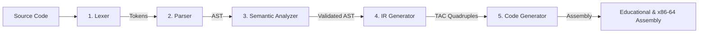

# Compiler Pipeline Visualizer

An interactive educational IDE and compiler pipeline visualizer that demonstrates how source code transforms into machine instructions across each phase of the classic compiler pipeline.

Built with Python (Flask) and a modern single-page web interface, this tool breaks down the compilation process into distinct, observable stages with rich visual representations, structured diagnostics, and a side-by-side stage difference comparison engine.

---

## Features

### 1. Full 5-Stage Compilation Pipeline
- **Stage 1 — Lexical Analysis (Scanner)**: Tokenizes source code into classified lexical tokens (`KEYWORD`, `IDENTIFIER`, `NUMBER`, `OPERATOR`, `PUNCTUATOR`, `TYPE`), complete with 1-based line and column coordinates.
- **Stage 2 — Syntax Analysis (Parser)**: Recursive-descent parser producing a hierarchical Abstract Syntax Tree (AST). Rendered as an interactive top-down tree diagram with zoom, pan, and collapsible subtrees.
- **Stage 3 — Semantic Analysis**: Builds a scoped symbol table, validates variable declarations, checks for uninitialized variable usage, and emits structured diagnostics.
- **Stage 4 — Intermediate Code Generation (IR)**: Translates the validated AST into linearized Three-Address Code (TAC) quadruples with explicit temporary variable management.
- **Stage 5 — Target Code Generation**: Dual-mode code generator producing:
  - **Educational Pseudo-Assembly**: Abstract 4-register (R0–R3) virtual RISC instruction set for teaching register allocation and LOAD/STORE semantics.
  - **x86-64 Gas Assembly**: Standard GNU Assembler syntax targeting Linux System V AMD64 ABI (%rbp activation frames, 16-byte stack alignment, and %eax return convention).
- **Stage 6 — Educational Explainer**: Stage-by-stage theoretical breakdown providing architectural explanations, concepts demonstrated, and key academic takeaways.

### 2. Stage Diff Mode (Side-by-Side Comparison)
- Compare two versions of a program (`Version A` vs `Version B`) side-by-side across all compiler stages:
  - Source lines diff
  - Token stream diff
  - AST structural JSON diff
  - Three-Address Code (TAC) diff
  - Target Educational Assembly diff
  - Native x86-64 Assembly diff
- Clean, on-demand execution: diffs are computed only when the user explicitly triggers comparison.
- Outdated state tracking: modifications to source code or target stages flag stale results and prompt re-evaluation.

### 3. Error Detection & Structured Diagnostics
- Stage-specific error reporting distinguishing lexical, syntactic, and semantic diagnostics.
- Offending line and column locations highlighted directly in the source editor.
- Stage-blocking logic: downstream phases (TAC, assembly) are blocked cleanly if syntax or lexical analysis fails, avoiding cascading or misleading outputs.

### 4. Interactive Pre-Configured Programs
Includes ready-to-run presets illustrating core compiler design principles:
- **Complete C Program**: Arithmetic, local variable declarations, and return statement.
- **Conditional Branching**: Relational comparisons (`score > 80`) with `if` / `else` control flow.
- **Operator Precedence**: Visualizing `3 + 4 * 2` where multiplication binds tighter than addition in the AST.
- **Lexical Error Demo**: Invalid token character detection with location coordinates.
- **Syntax Error Demo**: Malformed expressions illustrating parser recovery and diagnostics.
- **Semantic Undeclared Variable**: Use-before-declaration diagnostic.
- **Semantic Uninitialized Warning**: Declared variable read before initialization.
- **Toy Language Demo**: Alternative minimal programming language syntax.

---

## Architecture & Codebase Overview

```
compiler-pipeline-visualizer/
├── app.py              # Flask server and REST API endpoints (/compile, /diff, /presets)
├── lexer.py            # Lexical analyzer / tokenizer with position tracking
├── parser.py           # Recursive-descent parser constructing the AST
├── semantic.py         # Symbol table manager, type checker, and semantic diagnostics
├── ir_generator.py     # Intermediate representation generator (Three-Address Code)
├── codegen.py          # Assembly generator (Educational RISC & x86-64 GNU Assembler)
├── diff_service.py     # Stage-by-stage program difference engine
├── explainer.py        # Educational explanations and stage takeaways
├── index.html          # Primary single-page application frontend
├── static/
│   └── index.html      # Production-served static web frontend
├── test_pipeline.py    # Comprehensive compiler and API test suite (21 unit tests)
├── test_diff_mode.py   # Diff mode and UI lifecycle integration test suite (7 tests)
├── requirements.txt    # Project runtime and test dependencies
└── README.md           # Documentation
```

### Pipeline Flow


---

## Prerequisites

- **Python**: 3.10 or later (tested on Python 3.13)
- **Web Browser**: Any modern browser (Chrome, Firefox, Safari, Edge)

---

## Setup & Installation

1. **Clone the repository**:
   ```bash
   git clone https://github.com/giri-sayan/compiler-pipeline-visualizer.git
   cd compiler-pipeline-visualizer
   ```

2. **Create and activate a virtual environment** (recommended):
   ```bash
   # On macOS / Linux
   python3 -m venv .venv
   source .venv/bin/activate

   # On Windows (PowerShell)
   python -m venv .venv
   .\.venv\Scripts\Activate.ps1
   ```

3. **Install dependencies**:
   ```bash
   pip install -r requirements.txt
   ```

---

## Running the Application

1. **Start the Flask server**:
   ```bash
   python app.py
   ```

2. **Access the web interface**:
   Open your browser and navigate to:
   ```
   http://127.0.0.1:5000
   ```

---

## Running Automated Tests

The project includes 28 automated tests covering lexing, operator precedence, relational code generation, semantic analysis, diagnostics, diff comparison, and API responses.

You can run the tests using either `unittest` (standard library) or `pytest`:

```bash
# Using pytest
pytest -v

# Using Python unittest
python -m unittest discover -v
```

---

## Supported Language Scope

### C Subset
- **Functions**: `int main() { ... }` function definitions with return statements.
- **Declarations**: Explicit integer variables (`int a = 5;`, `int b;`).
- **Expressions**: Binary arithmetic (`+`, `-`, `*`, `/`, `%`), unary negation (`-x`), and parentheses overriding (`(2 + 3) * 4`).
- **Comparisons**: Relational operators (`==`, `!=`, `<`, `<=`, `>`, `>=`).
- **Conditionals**: `if (condition) { ... } else { ... }` blocks.
- **Preprocessor**: `#include <stdio.h>` recognized and stripped during lexing.

### Toy Language
- Minimalist imperative syntax supporting expressions, variable bindings, and sequencing.

---

## Academic Scope & Known Limitations

- **Control Flow**: Loops (`while`, `for`, `do-while`) are not supported in this educational subset; attempting to use them raises informative syntax error diagnostics.
- **Data Types**: Focused specifically on integer (`int`) arithmetic and boolean condition flags; pointers, arrays, structs, and floating-point types are excluded.
- **Binary Execution**: Assembly code is synthesized for static analysis and inspection. Native execution requires assembling and linking with an external toolchain (`gcc -no-pie` / `as`).
